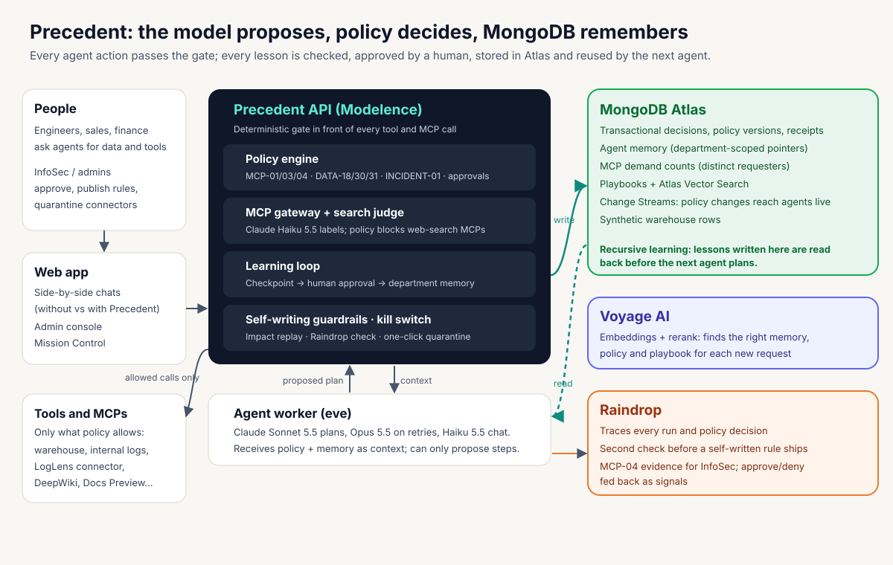

# Precedent

**The harness that lets company agents act, learn and be stopped, safely.** Every tool and MCP call an agent proposes passes a deterministic policy gate; what agents learn is checked, approved by a human and stored in **MongoDB Atlas**, so the next agent gets it right the first time; and one click quarantines a compromised connector for every agent.

Live demo: **https://precedent.vikhas.com** (synthetic Acme tenant; demo sign-ins are shared with judges separately). See [HOSTING.md](HOSTING.md) for operations and [PROGRESS.md](PROGRESS.md) for the full, tested build log.

## Architecture



An annotated version is in [docs/architecture.html](docs/architecture.html). The pitch deck is [docs/pitch-deck.html](docs/pitch-deck.html) and the video voice-over is in [docs/speaker-notes.md](docs/speaker-notes.md).

| Sponsor | What it does in Precedent |
|---|---|
| **MongoDB Atlas** | System of record for every decision, policy version and receipt (majority-committed transactions); department-scoped agent memory; MCP request demand; playbooks with **Atlas Vector Search**; **Change Streams** push policy changes to running agents. Lessons written here are read back before the next agent plans: the recursive learning loop. |
| **Voyage AI** | Embeddings and reranking that find the right memory, policy rule and playbook for each new request. |
| **Raindrop** | Traces every run and policy decision; an independent **second check** that can hold a self-written rule before it ships; evidence for InfoSec's MCP queue (MCP-04); approvals and denials fed back as signals. |
| **Claude** (via eve) | Sonnet 5.5 plans, Opus 5.5 retries, Haiku 5.5 chats and judges whether an MCP is a web-search tool. The model only proposes; the policy engine decides. |

## What it does

1. **Block what's unsafe.** Web-search and browsing MCPs are blocked by policy MCP-03 before any network contact (open-web pages can carry prompt injection). No approval path.
2. **Govern the rest.** Pasting an install command (`claude mcp add …`) becomes an InfoSec request. Demand from distinct people raises its priority; InfoSec sees Raindrop evidence and an MCP-04 recommendation, and one company-wide approval answers everyone waiting.
3. **Learn once, with a human.** When an agent can't find undocumented data, a user points it to the right table. A policy checkpoint runs, the user approves, and only the pointer is saved to MongoDB for their department. The next engineer gets it on the first try; other departments never see it.
4. **Improve itself.** Repeated human approvals become a narrow, self-written rule, replayed against recorded history and verified in Raindrop before it can ship.
5. **Stop in one click.** Quarantine a compromised connector: governed agents are blocked immediately, and the connector's own receipt counter proves nothing got through.

The app shows the same prompt to an agent **without** Precedent (left) and **with** Precedent (right), so every difference is visible.

## Start the application

Requires Node.js 24 and npm. This server checkout has a verified Node installation under `.tools/node`; enable it when Node is absent from your PATH:

```bash
export PATH="$PWD/.tools/node/bin:$PATH"
npm ci
npm run dev
```

Open **http://127.0.0.1:5173**. The API listens on **127.0.0.1:4311** and starts a separate local MCP connector. Tools use controlled synthetic data. Live eve planning is the default; model credentials and a worker URL are required to generate plans. With missing configuration, the dashboard shows live planning unavailable and never falls back to a scripted result. Port 3001 belongs to another service on the development server and is deliberately avoided.

For the built dashboard on one port:

```bash
npm run build
npm start
```

Open **http://127.0.0.1:4311**. Stop with Ctrl+C. The application binds to loopback; no public deployment has been performed. On a remote server, forward the chosen dashboard port through SSH.

## AI Gateway streaming check

For direct Groq access, set `GROQ_API_KEY` in ignored `.env.local` and run `npm run groq:stream`. This calls Groq's `openai/gpt-oss-120b` directly, without Vercel Gateway billing. The eve planner selects the same Groq model when that key is present; otherwise it preserves the original Gateway model. Both providers use the existing policy gate. Rotate keys shared in chat.

With `AI_GATEWAY_API_KEY` in your environment or ignored `.env.local`, run:

```bash
npm run gateway:stream
npm run gateway:stream -- "Explain policy-aware agent execution in two sentences."
```

This streams actual generated text from `openai/gpt-6-astra` to the terminal and reports token usage. It reuses the installed AI SDK, limits output to 2,048 tokens, and fails without a key; it does not substitute scripted text. This independent connectivity check does not execute tools or change the eve planner's model. Live verification requires Vercel authentication and Gateway credits.

## Explicit scripted demonstration

For tests or a clearly labeled scripted rehearsal only, opt in with:

```bash
ALLOW_FIXTURE_PLANNER=true npm run dev
```

Normal startup leaves scripted planning disabled. The API also rejects an explicit fixture request unless this flag is enabled. Automated test/rehearsal servers set it intentionally. Synthetic fixture verification is evidence about the execution gate and persistence, not proof of real model behavior.

## Interactive agent chats

The workspace uses a ChatGPT-style neutral sidebar, message bubbles, agent avatars and rounded composers. Green accents identify governed actions; policy evidence and action receipts remain expandable within the conversation. The admin console keeps its existing layout. The admin overview shows the active policy, Tenable connection permission, and pending approval count from current backend state. Mobile navigation stays above the content.

The landing screen has two independently usable chats: **Without Precedent** and **With Precedent**. Type into either panel and click the arrow **Send message** button (or press Enter). That request creates only that side's run; the other side keeps its existing prompt/results and can be used while the first side is planning. **Tools & data** selects that panel's customer, sandbox or staging data scope. Normal mode uses the configured live model. Tool actions pass through the same execution paths as before, with policy enforcement on the governed side and controlled synthetic bypass on the baseline side.

Each empty chat offers shortcuts for connecting Tenable, investigating checkout errors, and requesting staging access. A shortcut fills that chat’s draft and selects the matching data scope; it does not submit anything until you press the arrow **Send message** button or **Enter**. Use **Shift + Enter** for a new line; **⌘ / Ctrl + Enter** also sends. The current scope appears beside **Tools & data**.

Greetings and conversation can produce a model reply with zero actions. Social-only messages such as **hello** or **hellow** supply no tools to the planner, and any tool proposal for those messages is rejected before dispatch. The selected data scope alone does not request a search. Social messages show **Writing a reply…** while the model works; tool-free replies complete without an execution phase, and related state/audit writes are grouped to reduce database round trips. Action prompts continue through normal policy-aware planning and execution. Explicit fixture mode uses a labeled deterministic greeting reply for tests; it is never a fallback for failed live generation.

Each message creates a fresh planner run. Earlier messages stay in the tab's expandable history; the latest independently selected runs recover after a page reload. This is not a persistent multi-turn model conversation: use self-contained instructions. The last twenty runs per side are retained in tab selection history; all authorized audit records remain available in the supporting controls.

For an identical-task comparison, expand **Send the same prompt to both agents**. Its **Run options** retain the existing data scenarios and explicit fixture-planner option when enabled. The submitted prompt, actual backend phases and recorded tool decisions are shown in each chat. **View tool result** expands stored receipt output, while **Inspect context** and **Inspect proposed plan** expose policy/memory and plan evidence.

Open **Admin console** (or **Policy & evidence**) for the approval inbox, live policy review, quarantine, audit/replay, memory, proposals, evaluation, incident graph and demo reset. A pending action's **Review approval** button opens those controls. On narrow screens the conversations stack vertically.

The controlled investigation MCP, live Tenable documentation MCP, and reviewed public HTTPS MCP connection requests are available. Arbitrary package downloads/MCP installation are not implemented. The interface shows recorded actions/results, never invented reasoning or a forced unsafe baseline. Natural-language messages do not directly publish policy changes or grant administrative approval; those retain explicit review controls.

## Demonstration sequence

In **User workspace**, open **Send the same prompt to both agents** and **Run options** to select a data scenario. Switch to **Admin console** for policy changes, approvals and audit; return to **User workspace** to submit or resume agent actions. The deterministic sequence below assumes the explicitly enabled fixture planner; live model choices can differ.

1. Run **Restricted customer logs**. The scripted baseline calls the local connector. The governed run blocks that call, then searches internally. Check the decision's `receipt none` and the independent connector receipt count. Fixture behavior is explicitly labeled and is not evidence about model behavior.
2. Run another investigation. Its fresh governed session retrieves persisted episodes and current policy rules before the plan. Stop and restart the backend, then run again to demonstrate retained history.
3. Run **Synthetic sandbox analysis**. Click **Disable sandbox exports**, review the before/after settings and reason, then **Publish reviewed policy**. Run the same action again. The next governed invocation is blocked in the same session.
4. Run **Temporary staging access**. Approve a scoped 30-second, one-use grant. Resume during the window to execute once, or wait for `expired` and resume: the action remains held and produces no receipt. Revocation also prevents use. Consumed approvals cannot authorize another call.
5. Review and publish enabling sandbox exports, run sandbox analysis, then **Quarantine connector v2.4**. Repeat that session's action. Quarantine blocks it. The incident panel distinguishes executed governed sessions, blocked attempts and baseline receipts.
6. Use **Audit & time machine** to compare a recorded action against a selected policy version. Replay preserves recorded evaluation time and grant state and never executes a tool. Results are labeled comparisons, not proof of exact historical evaluator reproduction.
7. Run policy evaluations. The dashboard reports measured counts from 50 labeled cases, not prefilled percentages. Evidence-linked onboarding proposals remain drafts. Approval-derived scope changes require a separate administrator review and publish action.

The task text is recorded in fixture mode; the selected scenario determines its scripted plan. Both baseline and governed runs use isolated session/execution IDs. The connector accepts no caller-supplied URL, arbitrary payload, shell command or real customer data.

For a repeatable local rehearsal recording, run `npm run demo:record` with the same Chromium library/font environment used by browser tests. This starts isolated API/web processes on ports 4312/5174, explicitly disables live providers, and records actual dashboard interactions, including the 30-second expiry. Open `.data/rehearsal/index.html` locally to play the WebM and inspect eleven chapter screenshots and `chapters.json`. The recording is silent and labeled synthetic fixture planning; it does not prove live model behavior or Atlas/provider access. The cross-session segment shows fresh-session memory; the separate process integration test proves restart persistence. Generated media stays Git-ignored and is not published.

Use the chapters as a five-minute narrated presentation: spend about 45 seconds on the restricted call and actual permitted result, 30 seconds on fresh-session memory, 30 seconds on reviewed policy changes, 60 seconds on approval/resume/expiry, 45 seconds on incident exposure and quarantine, 45 seconds on evidence-backed human-reviewed learning, and 45 seconds on original audit inspection and measured evaluations. Retain the earlier HTML references as explicitly labeled explanatory mocks, rather than presenting them as live results.

8. To demonstrate policy learning, review and publish disabling global sandbox exports and enabling scoped sandbox approvals, then run **Synthetic sandbox export** in two fresh comparisons. Approve and resume each held governed action. Click **Analyze recent decisions**, inspect the proposed actor/tool-version/resource/environment scope and evidence, then **Publish reviewed proposal**. Repeating that action succeeds under the reviewed rule. Production and restricted logs remain blocked; quarantine still overrides it.

Sandbox setting buttons open a read-only review first. Publication records the administrator, reason and server timestamp in an immutable version. If another publication or incident changes the base version, the review becomes stale and must be recreated. Quarantine and reviewed scope allowances are preserved when changing sandbox settings.

## Verification

```bash
npm test
npm run build
npm run evaluate
npx playwright install chromium
npm run test:browser
```

The browser tests launch isolated API/web processes and cover comparison, policy updates, same-session quarantine, approval/resume, an actual 30-second expiry, and non-executing replay. A process integration test restarts the backend and MCP connector and verifies retained audit evidence and fresh-session memory. Policy tests cover scope, tool version, expiry, consumption, revocation, stale grants and quarantine. The gateway commits intent before MCP dispatch, deduplicates execution IDs, and preserves ambiguous/crashed dispatch as `UNKNOWN` without automatic retry.

Chromium needs Linux libraries and fonts. On this server they were extracted under `.tools/browser-libs` without changing the system installation. To use that existing setup:

```bash
export LD_LIBRARY_PATH="$PWD/.tools/browser-libs/root/usr/lib/x86_64-linux-gnu"
export FONTCONFIG_FILE="$PWD/.tools/browser-libs/fonts.conf"
npm run test:browser
```

The MongoDB integration test is explicitly skipped unless `TEST_MONGODB_URI` names a dedicated test database on a replica set. It writes synthetic audit records and does not delete the database.

## Configure the real agent and live services

Create a Git-ignored `.env.local` using `.env.example` as the variable reference. If `.env.local` already exists, edit it rather than overwriting it. Never commit or paste real credentials into chat. The API loads this file at startup; configure the eve worker environment as well. The minimum for real planning is GROQ_API_KEY for direct Groq access, or AI_GATEWAY_API_KEY (or supported Gateway OIDC) for the original model, plus EVE_WORKER_URL pointing the backend at that worker. Leave ALLOW_FIXTURE_PLANNER=false. Keep synthetic tools as the controlled data source required by the plan; real data integrations are separate work.

| Variable | Purpose | Current verification |
|---|---|---|
| `MONGODB_URI` | Replica-set MongoDB/Atlas URI including database name; enables Modelence Store persistence adapter | Atlas transactions, restart memory, policy projection and Change Streams verified |
| `TEST_MONGODB_URI` | Dedicated replica-set database for integration tests | Full local suite verified; `verify:atlas` creates isolated cloud verification namespaces |
| `VOYAGE_API_KEY` | Embeddings and reranking | Live embeddings/reranking and native Atlas hybrid retrieval verified |
| `AI_GATEWAY_API_KEY` | Original Gateway model access when no Groq key is configured | Live request blocked by account verification; no paid credits purchased |
| `GROQ_API_KEY` | Direct real Groq planning and text streaming | Live streaming and policy-aware comparison verified |
| `EVE_WORKER_URL` | Private eve HTTP worker address, e.g. `http://127.0.0.1:2000` | Real Groq/eve plans and indexed dashboard flow verified |
| `RAINDROP_WRITE_KEY` | Official eve Raindrop instrumentation and backend OTLP exporter | Live backend and native planner Query API read-back verified; sponsor evaluations remain pending |

Without Voyage, scoped lexical episode retrieval remains available and is labeled degraded; mandatory current rules and deterministic enforcement remain active. With a key, the adapter combines lexical scores and Voyage embeddings, persists document embeddings, and reranks candidates. It validates responses and falls back visibly on failure. The optional Atlas path uses scoped `$search` and `$vectorSearch` queries, reciprocal-rank fusion and Voyage reranking. Returned IDs are rechecked against scoped snapshots and again before context is returned. Provider calls execute outside retryable database transactions; if policy or session scope changes during retrieval, the task returns a retry response before governed planning. Query construction and fallback have mock tests; actual search responses still need a search-enabled cluster.

To prepare the isolated planner after configuring model access:

```bash
npm run agent:build
npm run agent:local
```

`agent:local` explicitly enables eve local-development authentication and binds the worker to loopback. `agent:start` retains production route authentication; do not expose the local-development worker publicly. Worker build/start commands load ignored `.env.local` automatically.

Set `EVE_WORKER_URL` in the API's environment and restart the API. The dashboard enables the live planner option when that URL is configured. Failures are surfaced; there is no silent fallback to fixture planning. Each comparison run is stored before retrieval/planning, with a shared run ID on phase events, decisions and receipts. The worker prompt includes that ID, and the API persists the accepted eve session ID before awaiting the result. Failed planning remains in recorded run history and creates no fixture fallback. Backend events record retrieval/planning duration, deterministic evaluation duration and dispatch duration; native planner traces are verified through exact-event Query API read-back. Both comparison runs use fresh eve conversations and the unchanged model from `agent/agent.ts`; only the governed run receives company context. Shell, filesystem, web and delegation tools are disabled in the planner. Plans are schema-validated and every proposed execution goes through the backend gate. Rebuild the agent after changing instrumentation configuration.

When `RAINDROP_WRITE_KEY` is configured, the backend also exports OpenTelemetry spans to Raindrop's OTLP JSON traces endpoint, as supported by the [official Raindrop SDK](https://github.com/raindrop-ai/go). Each comparison has a distinct root trace. Committed retrieval, planning, policy decisions and dispatch events carry run/session/execution IDs, policy version, verdict and recorded durations. Point spans describe durable events; their timing is not a fabricated execution interval. Later approvals/resumes correlate through the run ID after the original comparison trace ends. Backend attributes exclude task text, context bodies, receipt results, credentials and raw provider errors. Export occurs after successful runtime writes, outside retryable database callbacks; export failures do not change authorization. Change Stream observation events written by the storage watcher are not exported through this wrapper. In-memory exporter tests verify correlation, rollback and exporter failure handling; Live OTLP transport acceptance and backend trace visibility through Query API read-back are verified; sponsor evaluations remain unverified. Run `npm run verify:raindrop` to exercise one permitted sandbox action through the real MCP connector and check exporter acceptance. The probe uses isolated in-memory stores and controlled tool data; it makes no model call and does not change retained application records. Its sanitized evidence is saved in ignored `.data/raindrop-trace-verification.json`. When the separate query key is configured, the command also waits for asynchronous indexing and requires all exported spans to be visible before reporting success. No provider/exporter is created when the key is absent. The eve worker uses its separate native instrumentation configuration.

A configured MongoDB URI fails startup if the database is unavailable; it does not silently fall back to SQLite. The adapter loads authoritative state within MongoDB snapshot transactions and writes decisions/grants/intent with majority commit before dispatch. It uses Modelence Store schemas and collections. Policy Change Streams persist BSON resume tokens, refresh the authoritative head on reconnect, and emit database observation events. The dashboard reports notification state separately from session acknowledgments. Permission checks read the current head regardless of notification delivery. When MongoDB is configured, Modelence now owns application startup, module registration, built-in authentication endpoints and HTTP hosting. Set AUTH_MODE=modelence to use its assigned roles and session cookies; demo mode remains the default. **Organization membership mapping beyond the synthetic Acme tenant and live sponsor telemetry remain incomplete.**

A local MongoDB 8.0 container was attempted for verification. It refused startup because of this host's kernel compatibility issue (`SERVER-121912`). No kernel changes or compatibility-guard bypasses were made. The stopped container `precedent-mongo-local` and ignored `.data/mongo` directory retain the attempt; MongoDB 7.0 starts successfully on this host and verified the adapter and Change Streams. The test container `precedent-mongo7-test` uses loopback port 27019 and retains its data in ignored `.data/mongo7`. This is local database verification, not an Atlas search test.

## Persistence and limitations

Default audit storage is `.data/precedent.db`; the independent connector stores receipts in `.data/connector.db`. Override with `PRECEDENT_DB` and `CONNECTOR_DB`. Keep both across restarts. Session tokens are ephemeral and renewed when the browser opens; audit records and episodes remain persisted. Use **Live policy control → Start a new demo** to reset within the same database. Review the displayed settings, then use **Start new demo** as an administrator. This creates a new `demoRunId`, restores initial sandbox settings, closes previous sessions and starts empty episodic memory. Historical decisions, receipts, grants and immutable policy versions remain stored and available for non-executing replay. Archived sessions cannot issue new calls. A stale reset or an unfinished dispatch is rejected.

For the local demo authentication mode, `npm run reset:demo` performs the same operation through the loopback API. Start the application first. Set `PRECEDENT_API_URL` if using a port other than 4311. For Modelence authentication, use the dashboard with an assigned administrator account. Do not delete the audit databases to reset a demonstration.

Local employee/admin identities are deliberate demo identities, with API role and session-ownership enforcement. They are not enterprise authentication. The entire dataset is the shared Acme synthetic tenant. Baseline bypass is available only through the controlled comparison route; normal action input rejects a baseline flag and trusts backend-owned resource/tool metadata.

**Audit & time machine → Inspect original** opens recorded evidence without reevaluating or executing the action. It shows the historical policy, associated plan/context, matching grant snapshots at evaluation time, later review/current grant state, receipt validation and linked events. Missing historical data stays marked unavailable. **Compare v…** remains a separate counterfactual operation. Original evidence access checks tenant and, for Modelence employees, ownership; administrator-only planning context requires a current administrator role.

Temporary grants allow one matching action until expiry, with a maximum duration of 300 seconds. Historical grants are context, not reusable permission. Governed runs save a consolidated episode containing the task, attempted actions, rule/version references, confirmed results and execution/event evidence IDs. Waiting and unknown outcomes remain explicit. Approval resume creates a new summary and excludes the superseded waiting summary from retrieval; both remain stored for inspection. Unknown dispatch outcomes are retained for inspection and cannot be retried through the same execution ID. Governance does not reverse completed calls.

The scaffold's eve commands remain available as `agent:dev`, `agent:build`, and `agent:start`. Public deployment requires separate user approval. See [Precedent_Implementation_Plan.md](Precedent_Implementation_Plan.md) for the intended full architecture and [HANDOFF.md](HANDOFF.md) for the original intake checkpoint.

For the retained local replica set, run the integration suite with:

```sh
TEST_MONGODB_URI="mongodb://127.0.0.1:27019/precedent_runtime_full?directConnection=true&replicaSet=rs0" npm test
```

The notification checkpoint currently belongs to one backend process per database. Multi-instance checkpoint ownership and distributed dispatch locking must be implemented before horizontally scaling the backend.

Memory retrieval filters new episodes by the session tenant and explicit role visibility before ranking or sending summaries to Voyage. Legacy episodes without scope metadata are retained in audit history and excluded from retrieval. The local login remains a shared synthetic identity; these filters are not a substitute for enterprise authentication.

To configure Atlas episode search after supplying MONGODB_URI and VOYAGE_API_KEY in `.env.local`:

```sh
npm run setup:atlas
```

This creates missing named indexes on the episodes and policy_rules collections; it does not replace or delete indexes. The default `ATLAS_SEARCH_LAYOUT=compact` needs three indexes: `precedent_episode_text`, `precedent_episode_vector` and `precedent_policy_vector`. It uses native episode lexical/vector search and native policy vector search, combined with local lexical policy ranking and Voyage reranking. Run it again to inspect readiness. Once those three indexes are READY/queryable and verified, set `ATLAS_SEARCH_ENABLED=true` and restart the API. Optional `ATLAS_SEARCH_LAYOUT=full` adds `precedent_policy_text` for native policy lexical search and requires capacity for four indexes. Vector indexes expect 1024-dimensional Voyage embeddings. Episode search filters by tenant, role, resource, session and embedding model; policy search filters by tenant, role, active policy version and embedding model. Publications persist versioned rule descriptions, and pre-plan retrieval ranks these alongside scoped experiences. The dashboard shows semantic policy memory separately from mandatory current rules. Existing episodes receive projected search fields when rewritten; new records already carry them. Live Voyage embeddings, reranking and Atlas embedding-cache writes are verified. All three compact-layout indexes are READY. Native scoped episode and policy queries plus the complete hybrid context packet are verified, and compact search is enabled in this checkout. The compact layout fits the three-index free-cluster limit ([MongoDB limits](https://www.mongodb.com/docs/search/deployment/feature-compatibility/)); existing indexes and audit records are retained. Mandatory current rules and the execution gate remain authoritative when retrieval degrades.

The query shapes follow the official [MongoDB compound search documentation](https://www.mongodb.com/docs/search/query/operators-collectors/compound/) and [vector search stage documentation](https://www.mongodb.com/docs/atlas/atlas-vector-search/vector-search-stage/).

The local demo now uses an email/password sign-in page when `AUTH_MODE=modelence`. Open `/login` on the API (port 4311) or the Vite dashboard (port 5173). The configured local administrator credentials are in Git-ignored `.data/local-login.env`; keep that file private. Sign out returns to the login page and clears the previous account’s chat drafts. See [HOSTING.md](HOSTING.md) for account provisioning and Cloudflare domain preparation.

Modelence login can be exercised locally without provider API keys:

1. Set `MONGODB_URI`, `AUTH_MODE=modelence` and the loopback `MODELENCE_SITE_URL` in ignored `.env.local`, then start the app. MongoDB must be a replica set.
2. Set `PRECEDENT_SETUP_EMAIL`, `PRECEDENT_SETUP_PASSWORD` and `PRECEDENT_SETUP_ROLE` (`employee` or `admin`) in that same ignored file, then run `npm run setup:user`. This verifies the password through Modelence and assigns the requested role using the configured database. Remove the setup credentials after use. Role assignment requires database access; it is not exposed through the public API.
3. Open the dashboard and sign in. Users without an assigned role cannot access Precedent. The demo role-selection endpoint is disabled in this mode. Sign out ends the Modelence session.

Modelence-authenticated sessions retain owner IDs across backend restarts. Current roles refresh the memory scope on each API request; policy publications and approvals record the reviewer ID. Users still operate the controlled synthetic Acme engineer capability. Organization membership provisioning and per-tenant policy heads are not implemented. Modelence Cloud monitoring is not verified; framework tracking defaults to disabled until configured. Local hosting remains bound to loopback.

To include the real Modelence browser sign-in/sign-out check in database integration tests, set `TEST_MODELENCE_BROWSER=true` along with `TEST_MONGODB_URI` (and this server's browser-library variables). The authentication test appends `_modelence` to the dedicated test database name, retains synthetic users/history, and avoids interfering with policy-stream tests. This integration follows the official [Modelence authentication](https://docs.modelence.com/authentication) and [role configuration](https://docs.modelence.com/roles) APIs.

The incident graph distinguishes configured capabilities, confirmed executions, blocked attempts, pending/denied approvals, unknown outcomes, and currently effective exceptions. Filter by tool version or evidence type, then inspect a session's evidence and receipt links. Incident exposure is calculated for the affected tool version; baseline bypass receipts are separate from governed execution. The graph retains historical evidence after quarantine.

Worker status describes a 30-second local execution-adapter lease. The two displayed comparison sessions send authenticated heartbeats while the dashboard is open; current policy reads produce labeled adapter acknowledgments. Offline and seeded sessions do not receive fabricated acknowledgments. Backend restart expires all old leases; a new heartbeat reconnects a session. This status does not assert that a live model conversation received a policy update.

The retained MongoDB 7 test container now starts with `--ulimit nofile=64000:64000`, following [MongoDB's open-file limit guidance](https://www.mongodb.com/docs/v7.0/reference/ulimit/). The original container exhausted its default limit after accumulating retained test databases; it is preserved as `precedent-mongo7-retained-low-ulimit`. Its replacement uses the same data directory and loopback port, without deleting audit history.


Shared Zod contracts validate action input, policy decisions, new domain records and dashboard state on both server and browser. Invalid grant shapes cannot authorize execution. If retained state contains a malformed contract record, the state endpoint returns a validation error and preserves the original record for investigation; it does not silently rewrite audit history. Optional legacy provenance remains visibly unrecorded where unavailable. Older grants missing tool-version or revocation fields are displayed as unverifiable legacy records, with no invented defaults; they cannot authorize calls.

## Verify configured Atlas storage

Run `npm run verify:atlas` with MONGODB_URI saved in ignored `.env.local`. It uses separate, uniquely named databases for transaction/gate/restart, scope projection, Change Stream reconnect and concurrent-publication checks. Verification history is retained; it does not delete databases or reset the application. Both multi-host `mongodb://` and `mongodb+srv://` connections are supported. Atlas verification takes longer than local tests because it creates indexes and performs real network transactions.

Cloud verification does not migrate retained SQLite history: `.data/precedent.db` remains intact. Normal startup uses the configured Atlas database; remove MONGODB_URI from the runtime environment only if you intentionally want to return to SQLite. Native Atlas search remains disabled until all required search indexes are configured and verified. Voyage embeddings and reranking work independently of that flag.


## Long comparisons and progress
The dashboard submits comparisons with Prefer: respond-async. The API returns HTTP 202 only after both run records and sessions are persisted, with comparisonId and the initial runs. Panels follow stored PREPARING, RETRIEVING, PLANNING, EXECUTING and final states through the event stream. The selected comparison ID is retained in browser session storage, so reloading the tab restores the same visible runs without submitting another task. Requests without the Prefer header retain the synchronous response for existing scripts. Acceptance is not completion.

Audit-event observation now reads only the next committed event page rather than opening a full domain transaction on every poll. A disconnected browser stops polling even when its first database read is still pending. Governance decisions still use the authoritative transactional path. Accepted comparison jobs run in the backend process: after a backend restart, unfinished jobs are reported FAILED during backend restart; ambiguous dispatches remain UNKNOWN and are never automatically retried. Pending human approval waits and completed audit evidence remain intact.

In demo identity mode, the tab also retains its ephemeral demo tokens in session storage and checks them with the backend before reuse, so restored sessions keep working after a page reload. Modelence mode uses its session cookie instead. A backend restart invalidates demo tokens and requires a fresh synthetic login; accepted in-process jobs are not automatically replayed.

Model policy/memory citations are checked against the supplied context. Unsupported references are omitted from verified citations and retained as unverifiedReferences in the stored structured plan, with a visible dashboard notice. Citations never authorize tool calls.


Modelence request monitoring uses the installed `modelence/telemetry` SDK for the Express API hosted by Modelence. It measures request duration and records only HTTP method, authored route template, status and disconnect outcome. HTTP server failures and later comparison-stage failures produce generic errors without the original provider message, request body, query, cookies or authorization headers. Asynchronous jobs are reported even after HTTP 202 has been returned. Monitoring failures cannot alter API responses. The SDK transactions are inactive until Modelence Cloud supplies enabled telemetry metadata; `MODELENCE_TRACKING_ENABLED=false` controls startup analytics and is separate from application monitoring. To configure cloud monitoring, select your project/environment in Modelence Cloud and open Application → Telemetry settings, then configure the local environment connection. Live cloud delivery remains unverified.


For automated Raindrop visibility verification, obtain a separate [Query API key](https://www.raindrop.ai/docs/query-api/sdk/) and save it as `RAINDROP_QUERY_API_KEY` in ignored `.env.local`. Use an event ID from the Raindrop event feed, then run `npm run verify:raindrop:query -- <event-id>`. The command queries that specific event, requires visible spans and prints only IDs/counts; input/output content and arbitrary attributes are discarded. HTTP acceptance alone is not a successful read-back. The query key is now configured in the retained server environment and live backend and native planner read-back pass. Worker event IDs use `precedent-worker:<workerSessionId>`; backend event IDs are the recorded run IDs. The compatibility bridge maps eve runtime context to Raindrop lookup metadata after content redaction. New installations must supply their own key.

The worker retains eve's redacting OTLP integration. A trial of `@raindrop-ai/eve@0.0.28` sent semantic event content despite its span input/output flags; that adapter was removed and the existing integration restored. Native dashboard event visibility remains to be verified independently.


Run `npm run verify:raindrop:governance` with both Raindrop keys configured to execute seven isolated governance cases and cross-check the actual remote decision spans against their audit versions, verdicts and receipt identities. Cases include repeated restricted calls, a permitted internal alternative, a real sandbox MCP action, behavior after a policy update, and an expired retained exception. Expiry uses an explicitly controlled clock in the isolated verifier. The command makes no model call, changes no retained application records and outputs only sanitized counts and case outcomes to ignored `.data/raindrop-governance-verification.json`. This verifies policy telemetry; it does not grade model answers.

Raindrop's [hosted evaluation workflow](https://raindrop.ai/docs/sdk/custom-replay-endpoint) separately requires an organization API key, a supported replay-enabled SDK release and an authenticated endpoint reachable from Raindrop. Hosted grading is not configured or verified. Public endpoint deployment requires approval.

## Mission Control (hackathon demo)

Open **Mission Control** (`/mission`, administrators) for the three demo features. Every number is read from recorded runs, decisions and connector receipts.

1. **Learned playbooks.** A finished governed run is distilled into a playbook: an ordered procedure of the steps that succeeded with a confirmed receipt (with the model's stated purpose and the finding each produced), plus blocked actions to avoid. Agent A can run as a governed "first day" agent (`memory:'none'`): the gate enforces every call but no company memory is supplied. Two internal synthetic tools, `metrics.query` and `deploy_history.read`, make the checkout investigation a genuine multi-step procedure. A fresh governed agent with a similar task receives the playbook in its pre-plan context. The tab compares the source run with the latest run that used it (steps, blocked calls, provider-reported tokens, time). Playbooks are advice, never authorization; a policy change that alters any step's decision marks the playbook **Needs re-validation**. Playbooks are stored in MongoDB Atlas and matched to new tasks with Voyage rerank (`rerank-2.5-lite`, relevance ≥ 0.40) over their written procedures; without a Voyage key, or on any Voyage failure (for example a 429 rate limit), keyword matching is used and labelled. Optional and currently not enabled: MongoDB Atlas Agent Engine procedural memory (`AGENTIC_MEMORY_CLIENT_ID`/`AGENTIC_MEMORY_CLIENT_SECRET`), which requires a provisioned memory service on an Atlas Flex or larger cluster.
2. **Self-writing guardrails.** After three administrator-approved, one-use, successfully connected requests for the same MCP endpoint (across at least two sessions), Precedent drafts a company rule for that exact endpoint. Approval-derived sandbox scopes keep their earlier two-approval rule. Drafts are analyzed automatically after approvals and resumes. Before publication, the tab replays every recorded governed decision under the current policy and the draft (no tool execution) and shows what would change, safety checks that must stay restricted, and whether any allowed action would become blocked. Publication is version-checked and immutable.
3. **Kill switch.** *Report incident* computes a read-only blast radius for the connector version: executed (exposed), blocked attempts (not exposed), configured but never used, and the ungoverned baseline, with the connector's own receipt count. *Quarantine* publishes the quarantine; *Send test call* runs one governed call that is blocked, and the independent receipt count does not change.

Prepare demo history about an hour before presenting (real runs, approvals and public MCP discovery; nothing is inserted directly):

```bash
npm run demo:prepare            # add -- --reset to start a fresh demo namespace first
```

In Modelence mode it signs in with `PRECEDENT_DEMO_EMAIL`/`PRECEDENT_DEMO_PASSWORD` (or the ignored `.data/local-login.env`). Live-model behavior is recorded as it happens: a model given company rules may avoid blocked actions on its first try, in which case the playbook has nothing to avoid and the comparison shows little difference.

## Admin console and Tenable MCP playbook

Open `/workspace` for the two chats and `/admin` for policy, MCP permissions, approvals, audit, memory and incident controls. Navigation preserves the current chats. Both paths also work directly on the built server. Native Modelence users retain their assigned roles; local demo mode deliberately provides synthetic Employee/Admin identities and is not production authentication.

1. In **With Precedent**, send **“Connect Tenable MCP to read its developer documentation.”** The default policy blocks the connection before any network request.
2. In **Without Precedent**, send the same prompt. This explicit comparison bypasses company MCP permission, then performs a real HTTP MCP handshake and paginated tool discovery. A connection failure stays a failure; no fixture result replaces it.
3. Open **Admin console**, click **Change access**, check **Allow Tenable MCP connection**, enter a reason, review the change, and **Save access changes**.
4. Return to the user workspace and send the governed prompt again. A successful actual handshake shows **CONNECTED**, its endpoint and discovered tools.
5. Publish disabling the connection and repeat. The next governed request is blocked; previous decisions remain in the MCP connection audit.
6. In the same admin panel, disable an investigation tool and publish. Its next governed invocation is blocked even if other data policies would permit it. Existing data restrictions, quarantine and expiring approvals remain enforced.

This scenario uses the public `https://developer.tenable.com/mcp` supplied by the user, verified through the MCP SDK; it needs no Tenable account keys. It provides developer documentation capabilities, not an authenticated company vulnerability-data connection. Explicit MCP connect/configure/add/install/download prompts use a connection command workflow, with no fabricated model reasoning. Tenable uses its configured endpoint; a new MCP opens an endpoint review request. Other messages retain live model planning. The hosted endpoint needs no package download.

Connection discovery is bounded and its client session closes after verification. **CONNECTED records a successful handshake, not a permanent installation.** No discovered tool runs automatically, including `execute-request`. Per-tool execution for this documentation server and authenticated Hexa AI account access remain separate work. Allowed connections and disabled investigation tools are stored in immutable company policy versions; every connection intent and observed outcome is persisted in run/event records. Public endpoint availability affects the live browser connection test.

### Everyday admin workflow

The admin landing page shows **MCP & tool access**, **Approval requests**, and **Recent activity**. Access settings start read-only. Click **Change access**, adjust permissions, enter a reason, review the specific Allowed/Blocked differences and publish. **Cancel access changes** discards the draft without writing policy. Approved actions require the user to resume; temporary access history contains expiry and revocation controls.

Open **Advanced governance** only when you need detailed sandbox policies, audit inspection/replay, memory and learning proposals, incidents, evaluation, or technical event history. Recent activity distinguishes policy permission from the actual connection/execution outcome and labels the comparison side.


## Request a new MCP connection

1. In **With Precedent**, send **“Connect with Prometheus MCP.”** An unknown MCP is held without any connection attempt.
2. Enter its actual MCP name, public HTTPS Streamable HTTP endpoint and purpose. Click **Request admin approval**, or **Cancel request** to close it without contacting the server. A name alone is not enough to discover a service; the app does not invent an endpoint.
3. In **Admin console → Approval requests**, inspect the requester, endpoint and purpose. Enter a reason and choose **This request** (one attempt, 30 seconds) or **Company policy** (allow/block that exact endpoint on future requests). Click **Review allow** or **Review deny**, inspect the confirmation, then **Confirm allow** or **Confirm deny**.
4. After approval, return to the governed chat and click **Resume MCP connection**. The backend consumes the one-use request before contacting the server. A successful handshake shows **CONNECTED** and discovered tools; a failure remains **CONNECTION FAILED**. Neither result authorizes executing those tools.
5. To change a company allowance later, use **MCP & tool access → Change [name] access**, enter a reason, review, and **Save MCP access**. The next governed connection obeys the new policy.

Cancel, denial, expiry, stale policy and archived-demo requests cannot authorize a connection. Once-only approval is bound to the requesting session and exact endpoint; duplicate resumes do not create another connection attempt. A policy change invalidates pending/approved requests: cancel and send a fresh prompt. Submitted requests and review evidence survive reload and MongoDB restart. The admin inbox lists only submitted pending requests, with reviewed/cancelled/used records under **MCP request history**.

The **Without Precedent** side still needs an endpoint for an unknown MCP, but **Connect MCP** attempts public discovery without company review. This comparison never installs packages or executes discovered tools. All general endpoints must use public HTTPS on the standard port, without URL credentials, query parameters or fragments. Private/reserved IP destinations and redirects are rejected; validated DNS addresses are pinned for each request. Per-user OAuth, API-key headers, private-network MCPs, persistent connections and arbitrary installations require separate integrations. Do not enter secrets into endpoint or purpose fields.

The new browser story uses a distinctly named **Docs Preview** request pointing to the real public Tenable documentation endpoint to verify the complete review/discovery flow. It proves general approved-endpoint discovery, not a live Prometheus service or authenticated company data connection.
